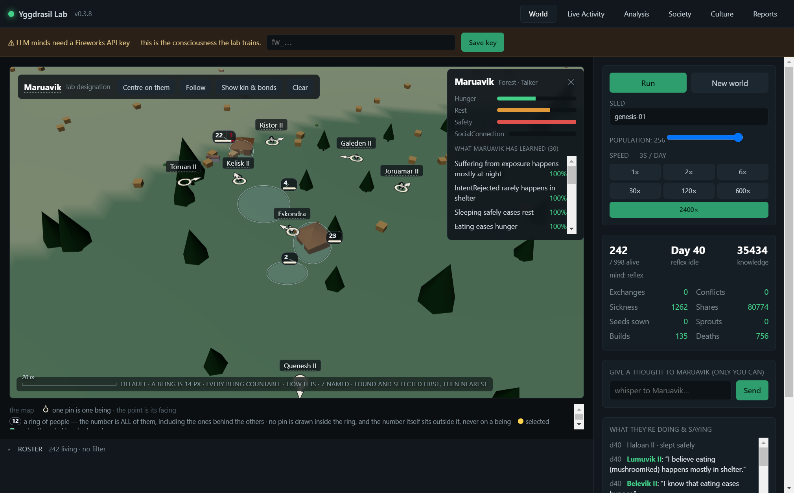

# Milestone 2 (November 2026) — verified research baseline

**Build under evaluation:** Yggdrasil Lab **v0.3.8**, tag `milestone-2-baseline`.
**Evidence taken at commit:** `072885f` (clean working tree), 20 November 2026, Windows 11, Node 24.13.1, AMD Ryzen 9 9950X3D.
**No language model was called for anything on this page.** Every run uses the engine's built-in authored policy (`backend: reflex`), so there is no cost and no outside source of variation.

The project's direction changed on 10 November 2026 (see [the direction-change note](../../rework/CAMPAIGN.md)). The research now starts with one mind: can a being discover an unfamiliar material rule and reproduce it later (experiment M02)? Before any new mechanism is built, this milestone answers a narrower question: **what does the existing engine actually do today, measured again, on a pinned commit?**

## What this milestone adds

| Item | Where |
|---|---|
| Research-baseline runner: seeded runs, same-seed repeat check, throughput, JSON/CSV export | [`packages/engine/baseline/`](../../../packages/engine/baseline/) |
| One command that produces every file on this page | [`run-evidence.sh`](run-evidence.sh) |
| Dated evidence files from that command | this folder |
| Direction change recorded in the engineering log | [`docs/rework/CAMPAIGN.md`](../../rework/CAMPAIGN.md) |

The desktop lab application itself is functionally the same as v0.3.7. The progress in this milestone is verification, not new features.

## 1. The build is pinned and the suites pass

Source: [`05-full-test-suites.txt`](05-full-test-suites.txt)

| Package | Type-check | Tests |
|---|---|---|
| engine | clean | 931 passed (64 files) |
| db | — | 24 passed |
| mcp-server | — | 37 passed |
| lab | clean | 511 passed (11 files) |

## 2. Three seeded scenarios, plus a scale probe

Source: [`baseline-summary.txt`](baseline-summary.txt), [`baseline-metrics.csv`](baseline-metrics.csv), [`baseline-results.json`](baseline-results.json)

| Run | World | Beings | Sim days | Alive at end | Births | Deaths | Events | Things said | Knowledge held |
|---|---|---|---|---|---|---|---|---|---|
| classic-100 | 2 km plane | 100 | 2 | 121 | 24 | 3 | 7,664 | 761 | 1,123 |
| continent-60 | true-scale continent | 60 | 2 | 60 | 15 | 15 | 2,120 | 501 | 514 |
| classic-300 | 2 km plane | 300 | 1 | 319 | 23 | 4 | 12,343 | 332 | 1,871 |
| classic-1000 | 2 km plane | 1,000 | 0.25 | 1,000 | 0 | 0 | 416 | 8 | 57 |

Deaths recorded as `violence` include animal attacks; the same runs record zero fights between beings. The 1,000-being run is a speed probe only: a quarter of a day is too short for anything to happen.

## 3. Same seed, same world

Source: [`baseline-results.json`](baseline-results.json) (`checks`), [`04-determinism-replay.txt`](04-determinism-replay.txt)

A fingerprint is a hash over every entity, body, memory, belief, relationship and counter in a run.

| Check | Result |
|---|---|
| Each of the four runs repeated from the same seed gives an identical fingerprint | 4 of 4 |
| Running the whole command twice in separate processes gives the same four fingerprints | yes |
| 2,400 + 2,400 ticks equals 4,800 ticks in one call | yes |
| A different seed gives a different world (fingerprint and metrics both differ) | 3 of 3 |
| Existing determinism, golden-state and record/replay tests | 48 of 48 |

**Limit of this claim.** This holds when no hosted model is involved. A run that calls the hosted model is not repeatable from its seed: the model is sampled with randomness. Every raw model reply is stored, and the stored prompt is rebuilt byte-for-byte by the record tests above, but **nothing yet feeds stored replies back into a run**. That replay step is planned work, not a result.

## 4. The mind is kept apart from the world

Source: [`03-world-adapter-audit.txt`](03-world-adapter-audit.txt) — 225 of 225 tests in 7 files

What those tests establish, in the order a reviewer would ask:

- The mind's code compiles against a repository with no world in it, and stops compiling when a mind file reaches into the world.
- No mind file names any part of the forager world; the scan follows imports, re-exports and the package entry point.
- The same mind runs in a second, toy world that has no coordinates, using that world's own events and roles.
- A place handed out by one world is refused by another.
- Moving the world's tables out of the mind changed no value (transcription tests).

## 5. What "communication" is today

Source: [`baseline-metrics.csv`](baseline-metrics.csv), [`stored-run-speech.csv`](stored-run-speech.csv)

| Run | Model | Things said | Engine-copied belief (`share-knowledge`) | Share |
|---|---|---|---|---|
| classic-100 (today) | none | 761 | 561 | 73.7% |
| continent-60 (today) | none | 501 | 480 | 95.8% |
| classic-300 (today) | none | 332 | 326 | 98.2% |
| stored run 1 (100 beings, 20 days) | hosted | 18,825 | 18,337 | 97.4% |
| stored run 2 (100 beings, 20 days) | hosted | 24,037 | 23,555 | 98.0% |

In a `share-knowledge` act the engine copies one belief from the speaker's own store to listeners in earshot, discounted by trust. The rest are `inform` acts. No run contains a question (`request`) or a shared story. The words of an utterance are never given to a listener's reasoning. So earlier "teaching" results are engine-mediated transfer, and none of them counts as one being understanding another.

## 6. A previous figure that did not reproduce

Source: [`02-throughput-bench.txt`](02-throughput-bench.txt), [`06-throughput-then-vs-now.txt`](06-throughput-then-vs-now.txt)

Earlier project reports gave about 400 simulation steps per second at 1,000 beings. That was measured in September.

| Beings | September commit | Today's code | Ratio |
|---|---|---|---|
| 100 | 4,296 | 4,207 | 0.98 |
| 300 | 1,885 | 1,408 | 0.75 |
| 1,000 | 343 | 180 | 0.52 |

Same benchmark, same machine, taken within a minute of each other while other applications were using the processor, so the ratio is the finding and the absolute numbers are low. **At 1,000 beings the current engine runs at about half its September speed.** The cause has not been isolated. This is recorded as a regression to profile, and the 400 figure should not be quoted for the current build.

## 7. The built application

Source: [`07-accept-log.txt`](07-accept-log.txt), [`07-accept-report-full-run.json`](07-accept-report-full-run.json), [`07-accept-report-rerun-roster-shelter.json`](07-accept-report-rerun-roster-shelter.json)

The installer `YggdrasilLab-Setup-0.3.8.exe` was built from commit `072885f` (SHA-256 `9bd5c629d4871b380a177a47607475b3302a70e3865886709e1b39c28a7f1b8f`). The lab's acceptance harness then started the built application, drove it with real input and checked what was drawn against the simulation's own state.



| | Result |
|---|---|
| Application starts; no shader, console or window errors | pass |
| Full run, 12 checks | **8 pass, 4 fail** (`offers`, `roster`, `perf`, `shelter`) |
| `roster` and `shelter` re-run on their own straight afterwards | both pass |
| `offers` and `perf` | the same two that failed in October (10 of 12 then) |

The full run was taken while other applications were using the processor, and `perf` is a frame-rate bar (55.3 and 57.9 frames per second against a bar of 59.5). `roster` and `shelter` failing once and passing on re-run means they are not stable under load; that is reported here as a fail, not rounded up. The lab's 3D view is frozen by decision of 10 November 2026, so these four checks are not being worked on; the research needs the engine and the run records, which sections 1 to 5 cover.

## Known problems, stated plainly

- **Throughput regression** at 300 and 1,000 beings (section 6).
- **Continuous integration is red on GitHub.** One database test (`bounded-query`, orphan-process safety) fails on the Linux runner and passes on Windows, where all the results above were taken. Not yet fixed.
- **The fast policy is still authored.** Nothing in this build learns which action to take from its own outcomes.
- **Installer is unsigned**; Windows SmartScreen asks for confirmation.

## What this milestone does not claim

- M02 (discovering an unfamiliar material rule), M03 (a skill that improves with practice), S01 (knowing what another being does not know) and C01 (teaching that is retained) are **not built and not tested** here.
- No new result about learning, personality, conversation or civilization.
- No hosted-model run was made, and none was needed.

## Reproduce it

```
pnpm install --frozen-lockfile
pnpm --filter @yggdrasil/engine baseline        # section 2, 3 and 5 (about 25 seconds)
bash docs/capstone/m2-baseline/run-evidence.sh . <output-folder>   # everything
```

## Next

Build the unknown-materials world for M02: generated materials with hidden rules, a check that no hidden rule reaches a mind, and a learning-disabled control. Record-and-replay of stored model replies comes with it.
