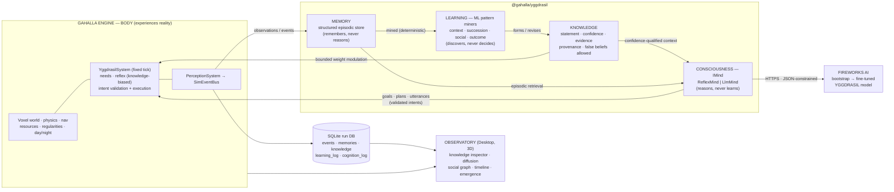

# Yggdrasil — Artificial Life & Emergent Civilization Research Platform (Design V2)

**Status:** ACTIVE design doc. V1 drafted 2026-06-12; **V2 revision same date** after a user design correction. This doc **redefines the name Yggdrasil**. The previous Yggdrasil — the per-NPC dialogue brain in [[yggdrasil_v1_design]] / [[yggdrasil_future_directions]] — is **DEPRECATED** as a direction (the engine `npc/` adapter and live dialogue keep working as legacy code; no new roadmap work). From this date forward, Yggdrasil means the system described here.

**The V2 correction (load-bearing):** V1 still placed too much responsibility on the LLM — it formed beliefs through reflection calls. That was wrong. **The LLM is not the source of knowledge. The world is the source of knowledge.** Gahallians learn from living in the world, not from being told what is true. V2 splits the old "Mind" into three separate systems — Memory, Learning, Consciousness — and moves all belief/knowledge formation out of the LLM into a machine-learning discovery layer that mines each agent's own experiences.

**Companion doc:** [[gahalla_mcp_server_plan]] (MCP server — parallel track, independent deliverable).

---

## 0. Vision & Scientific Objective

### The research question

> Can autonomous synthetic beings placed into a persistent world **discover knowledge, develop beliefs, share information, and eventually create civilizations** — without those civilizations being programmed?

Yggdrasil is a research project, not a game feature. Entertainment value is a byproduct. The product of a run is **data**: an append-only event log plus the full memory, knowledge, and cognition record of every being, from which we can study whether (and how) knowledge and society emerged.

The beings are called **Gahallians**. They live in a persistent world simulated **inside the Gahalla Engine** — not a detached sandbox. The engine provides the body and the world; Yggdrasil provides memory, learning, and consciousness; the Observatory provides the research instruments.

### The Loop (the foundational principle)

```
Reality creates experience.
Experience creates memory.
Memory creates learning.
Learning creates knowledge.
Knowledge enables reasoning.
Reasoning creates action.
Action changes reality.
```

Every architectural decision below exists to keep this loop closed and honest. Nothing may shortcut it: the LLM may not inject knowledge that didn't come from experience; the engine may not inject behavior that didn't come from reasoning or reflex; knowledge may not appear without memories as evidence.

### The Anti-NPC Doctrine (unchanged from V1, still enforceable)

Nothing social is ever hardcoded. **No jobs. No roles. No classes. No factions. No kingdoms. No leaders. No religions. No guilds. No governments. No professions. No cultures. No technology trees.** If a Gahallian becomes a farmer, it is because it *discovered* that seeds become plants and *reasoned* its way to planting — not because a farming system exists.

1. **Schema rule.** No schema anywhere — agent state, components, DB tables, prompt formats, mind outputs — may contain a `role`, `job`, `class`, `faction`, `kingdom`, `title`, `rank`, or equivalent field. The validator treats such a field as a defect.
2. **Genesis rule.** A Gahallian comes into existence with only: identity (name, age), personality traits, needs, physical capabilities, and current perception. Never a social identity, never an occupation, never knowledge it didn't earn, never a backstory.
3. **Belief rule.** Social constructs — ownership, leadership, alliances, norms, group membership — may exist **only inside agents' knowledge** ("I believe Sarah leads us") and in post-hoc analysis. They are never engine state. The engine cannot check "is this theft?" because theft is not a physical concept.
4. **Knowledge rule** *(new in V2)*. No knowledge is ever authored by a developer or generated by the LLM. Every knowledge record must trace to memories via evidence links, or to testimony from another agent (which traces to *that* agent's evidence, or further testimony). The Observatory can audit any belief back to the experiences that created it.
5. **Measurement rule.** Success is measured from the event log — patterns found after the fact — never by a programmed feature activating. There is no `DiscoverAgriculture` event type to fire.

One deliberate nuance: the **Observatory may classify post-hoc**. "Observed Archetype: Farmer" may appear as an analysis-side label derived from behavior history. The simulation never sees it; no agent is told what it is.

### What success looks like

- An agent that has repeatedly found berries near water **searching near water when hungry** — and we can show the knowledge record and the memories that produced it.
- **False knowledge arising and persisting**: an agent that concluded "rain causes death" from a coincidence, behaving accordingly. Superstition, myth, and culture grow from imperfect pattern recognition — the system must permit being wrong.
- **Knowledge outliving its discoverer**: agent A discovers seeds→plants, teaches B, A dies, B's descendants-in-knowledge still plant. That is the operational definition of culture here: *knowledge surviving longer than individuals*.
- Cooperation networks, leadership patterns, trade chains, migration, norms — emerging unscripted and measurable from the log.
- **Outcomes we did not program and cannot fully predict.** The honest success criterion is being surprised by the data.

---

## 1. The Four Systems

V1 had two layers (Body / Mind). V2 has **four, strictly separated**. Each has one job and explicit non-responsibilities; the separations are the architecture.

| # | System | Substrate | Job | Must NOT |
|---|---|---|---|---|
| 1 | **BODY** | Gahalla Engine (deterministic, per-tick) | Exist physically: movement, perception, physics, needs decay, inventory, gathering, building, combat, communication transport, death | Think, learn, or hold opinions. The body only **experiences reality**. |
| 2 | **MEMORY** | `@gahalla/yggdrasil` memory store | Record experiences as structured historical events | Reason, generalize, or learn. Memory only **remembers**. |
| 3 | **LEARNING** | Machine learning (statistical pattern discovery, in-process, no LLM) | Analyze memories, discover patterns, produce and revise **knowledge** | Decide, plan, or act. Learning only **discovers**. |
| 4 | **CONSCIOUSNESS** | LLM (Fireworks-hosted) | Reason, plan, communicate, create, solve problems — *using* knowledge | Learn, discover truths, or create beliefs. Consciousness only **thinks with what the agent knows**. |

The flow between them is exactly the Loop: Body → events → Memory → mining → Knowledge → prompts → Consciousness → intents → Body.

**Why this matters (the V2 insight):** in V1, asking the LLM to reflect memories into beliefs meant the model's pretrained worldview leaked into the agents — an LLM "knows" agriculture exists. By moving discovery into a dumb, evidence-counting learner, an agent can only know what its life (or its informants' lives) actually demonstrated. The LLM reasons brilliantly over a knowledge base it is not allowed to invent. Discovery stays earned.

---

## 2. Code Layout (engine-native)

```
packages/yggdrasil/               @gahalla/yggdrasil — pure TS, NO engine imports
  src/
    contract/                     Body⇄Yggdrasil contract types: AgentSnapshot,
                                  Observation, MemoryRecord, Intent (closed verb
                                  union), MindOutput, SimEvent
    memory/                       MemoryStream (structured episodic store),
                                  retrieval (recency×importance×relevance),
                                  IEmbedder (local ONNX | Fireworks API)
    learning/                     ILearner + the pattern miners (§6):
                                  ContextMiner, SuccessionMiner, SocialMiner,
                                  OutcomeMiner; evidence/confidence math;
                                  statement templating
    knowledge/                    KnowledgeStore: records, lifecycle, provenance,
                                  testimony intake, contradiction handling
    relationships/                RelationshipStore (deterministic deltas ONLY in V2)
    consciousness/                IMind, ReflexMind, LlmMind; IMindBackend,
                                  FireworksMindBackend; prompt builders + JSON schemas
    scheduler/                    CognitionScheduler (budgeted async queue,
                                  salience gating) + LearningScheduler
                                  (consolidation passes)

engine/src/yggdrasil/             The Body (engine-internal; imports contract types only)
    GahallianBody.ts              Component: needs, inventory, health, position, current intent
    YggdrasilSystem.ts            Fixed-timestep tick: needs decay, reflex execution,
                                  intent validation + execution, death
    PerceptionSystem.ts           Radius + light-modified observation stream per agent
    ResourceNodeSystem.ts         Trees/food/stone/water: finite stock + regrowth
    WorldRegularities.ts          The discoverable physical mechanics (§3): seed
                                  sprouting, sickness sources, exposure, regrowth bias
    SimEventBus.ts                Typed event bus (same pattern as engine/src/core/EventBus.ts)

desktop/src/renderer/src/editor/  The Observatory: new workspace mode + Dock panels
                                  (existing registry.tsx / Dock.tsx / panels.tsx pattern),
                                  sim hosted inside GameRuntime3D
```

Run persistence (SQLite per run, better-sqlite3 + WAL) lives at the runner boundary — desktop main process or a Node side-process — never inside the sim core.

### Reproducibility (research requirement)

- Authoritative agent-relevant state — needs, inventories, health, relationships, positions at nav-grid resolution — advances on a **fixed-timestep deterministic loop**, seeded via the existing `packages/worldgen` PRNG (`mulberry32` / `seedFromTuple`).
- **The learning system is deterministic**: same memory stream in, same knowledge out. It is replayable and participates in determinism tests. Only consciousness (the LLM) is nondeterministic, and its outputs are logged.
- Reproducibility mechanism is **event-log replay**: re-feed a run's recorded mind outputs into a fresh world with the same seed and obtain the same history — including identical knowledge formation, because learning is deterministic.
- A **headless harness** (same systems, no renderer) exists *only* for CI determinism tests and batch experiment runs. The product surface is the desktop 3D Observatory (§12).

---

## 3. The World — Reality Must Contain Discoverable Regularities

Deliberately simple terrain, but **the world is the textbook**: every regularity an agent might learn must physically exist as a body-level mechanic, never as a system, tech tree, or label. New emphasis in V2 — the world is designed as a set of *learnable truths* (and learnable coincidences).

- **Terrain:** the engine's streaming voxel world (`VoxelStream`, analytic chunk-free `surfaceZ` queries) — hills, water, open ground.
- **Resources:** trees (→ wood), berry bushes (→ food), stone deposits, water — placed by the existing worldgen scatter pipeline with **biased distributions that are real regularities** (e.g., berry bushes genuinely cluster near water; stone genuinely clusters at elevation). Finite stock, slow regrowth — scarcity is the engine of social behavior.
- **Seeds (the agriculture regularity):** harvesting food sometimes yields seeds as inventory items; a seed deposited on soil sprouts into a food plant after time. That is the *entire* mechanic — a physical fact of the world. There is no "farming system," no plant/harvest UI concept, no agriculture flag. If agriculture happens, it happens because some agent *learned* seed→plant and some consciousness *decided* to exploit it.
- **Hazards (false-belief fuel):** one mushroom kind causes sickness when eaten (a real regularity); night exposure without shelter drains safety/health (a real regularity); and ordinary coincidences (a death during rain) provide raw material for **superstition** — regularities that aren't.
- **Day/night cycle:** rest pressure at night, reduced perception radius in darkness.
- **Death is real:** starvation, sickness, exposure, violence. A corpse drops its inventory. Death events propagate to all witnesses' memories.
- **Building = physical primitives only:** wall segment, shelter (reduces exposure), storage container. Containers have **no access control** — "theft" can only exist as a judgment in some agent's knowledge.
- **What the world does NOT contain:** kingdoms, cities, factions, scripted settlements, spawn-roles, quest givers, technology trees, recipes (beyond physical primitives), or any text telling an agent how the world works.

---

## 4. Gahallian Architecture

### Identity

`id`, a generated name, age (advances with sim time), birth tick. Nothing else — per the genesis rule, identity carries zero social information and **zero knowledge**.

### Personality — six fixed traits

Rolled at genesis from the seeded PRNG, 0–100, immutable for life:

`curiosity · aggression · compassion · ambition · loyalty · riskTolerance`

Traits parameterize all the subjective layers: reflex weights (a high-compassion agent's share-willingness threshold is lower), learning disposition (curiosity raises exploration, which generates more diverse memories to learn from), and consciousness prompts (the LLM plays the personality).

### Needs — Phase 1 set

`hunger · rest · safety · socialConnection`

Per-tick decay (modulated by activity and environment), thresholds escalating comfortable → pressing → critical. Critical needs dominate the reflex layer; pressing needs are surfaced to consciousness as context.

**Designed extension point — future needs (NOT Phase 1):** `status`, `achievement`, `legacy`, `influence`. The needs system is table-driven so adding a need is data + one decay function. Advanced civilization markers (monuments, succession, ambition-driven conflict) likely require them.

### Two-layer control

| Layer | Cadence | Nature | Job |
|---|---|---|---|
| **Reflex** | every body tick | deterministic, in-engine | Keep the agent alive and execute the current plan. Urgent-need override, plan-step execution, trait-modulated micro-decisions. **Knowledge-modulated in V2** (§7): high-confidence knowledge biases reflex choices (where to forage, whom to approach, what not to eat) in bounded ways. |
| **Consciousness** | scheduled + event-triggered (§8) | LLM (or ReflexMind fallback) | Set goals, produce plans (intent sequences), decide utterances, design *experiments* ("what happens if I put this seed in the ground on purpose?"). |

The full agent loop: **Observe** (perception → memories, continuous) → **Learn** (asynchronous mining passes, §6) → **Think/Plan** (scheduled consciousness call consuming knowledge) → **Act** (reflex executes the plan as validated intents) → **Remember** (memory writes from events). Reflection-as-LLM-call is **gone** — consolidation is the learning system's job now.

Between consciousness calls an agent is never helpless — the reflex layer is a complete, dumb survival policy, and it already benefits from learned knowledge. If the LLM backend is down, the world keeps running and **keeps learning**.

---

## 5. MEMORY — The Experience Record

Memory stores experiences. Memory does not reason. Memory does not learn. Memory only remembers.

### The record (structured for mining, in V2)

Every meaningful event an agent perceives becomes a memory:

```
{
  tick, type,                    // GatherSucceeded, AteFood, BecameSick, SawAgent,
                                 // ReceivedItem, WasAttacked, WitnessedDeath, HeardUtterance,
                                 // PlantSprouted, BuildCompleted, PlanFailed, ...
  subjects[],                    // agent ids involved
  objectKind,                    // berry | seed | mushroomRed | wood | stone | shelter | ...
  context: {                     // the miner's feature space — captured AT THE MOMENT
    nearWater, terrain, elevationBand, timeOfDay, weather, indoorsShelter, ...
  },
  needDeltas,                    // what it did to hunger/rest/safety/social, if anything
  outcome,                       // success | failure | n/a
  summaryText,                   // human/LLM-readable one-liner
  importance,                    // deterministic heuristic by event type + magnitude
  embedding                      // for retrieval only (local ONNX, bge-small class;
                                 // Fireworks embeddings API behind the same IEmbedder)
}
```

The structured fields exist **so the learning system has a feature space to mine**. The text + embedding exist so consciousness can retrieve episodes for prompts. Same record, two consumers.

- **Importance is purely deterministic in V2** (event-type base × magnitude). V1's LLM-adjusted salience is removed — the LLM no longer touches the memory store.
- **Retrieval** (for consciousness prompts): `score = recencyDecay(tick) × importance × cosineSimilarity(query, embedding)` — top-K under the prompt budget.
- Old raw memories decay into an archive tier: out of the retrieval hot set, **never deleted from the run DB** (they are evidence and research data), and the learning system's accumulated counts persist regardless.

Memories are subjective: an agent only records what it perceived. One global event truth, N partial views — the gap is where rumor and divergent worldviews come from.

---

## 6. LEARNING — Discovery by Machine, Not by Model (the V2 centerpiece)

The purpose of machine learning here is **not optimization. It is discovery.** The learning system analyzes an agent's memories and discovers patterns, without developer intervention and without an LLM.

### What it is

Per-agent, deterministic, interpretable **statistical pattern mining** over that agent's own memory stream (including testimony and observation memories). Four miner families at launch, all behind one `ILearner` interface:

| Miner | Pattern shape | Example discovery |
|---|---|---|
| **ContextMiner** | outcome-event ⇆ context-feature association: lift of `P(event \| context)` over base rate `P(event)` | *"Food is commonly found near water"* — `FoundFood` co-occurs with `nearWater` far above chance |
| **SuccessionMiner** | event A → event B within a time window, at same/nearby location, above chance | *"Seeds appear connected to plant growth"* — `SeedDeposited(here)` precedes `PlantSprouted(here)`; *"the red mushroom makes me sick"* — `Ate(mushroomRed)` precedes `BecameSick` |
| **SocialMiner** | per-partner action↔response contingency and outcome tallies | *"Cooperation with John increases survival"* — `IGave(John)` reliably followed by `JohnGave(me)`; *"John is trustworthy"* / *"Kira is dangerous"* |
| **OutcomeMiner** | own action → need-delta correlation, conditioned on context | *"Sleeping in shelter restores more rest"*; *"gathering at night goes badly"* |

These are association rules, succession statistics, and contingency tables — **deliberately not deep learning.** Three reasons: (1) *interpretability is a research requirement* — the Observatory must answer "why does it believe that?" with actual evidence, which evidence counters give for free; (2) *determinism* — same memories in, same knowledge out, so runs replay exactly; (3) *cost* — counting is free at 1,000 agents; every agent learns continuously at zero marginal inference cost. Fancier miners (sequence mining, causal discovery) can be added behind `ILearner` later if the simple ones plateau.

### How it runs

- **Streaming counts:** every memory write updates the relevant counters incrementally (cheap, O(features)).
- **Consolidation passes:** on a schedule (biased toward the agent's sleep — consolidation-during-rest, which is also thematically right), the `LearningScheduler` runs each miner over its counters: promote, reinforce, weaken, or abandon knowledge records (§7). Deterministic and part of the replay.

### The license to be wrong

There is **no truth oracle**. The learner never checks a pattern against world config. A coincidence with enough repetitions becomes held knowledge: *"rain causes death"* is a legitimate output if the agent's life contained that correlation. False beliefs, superstition, myth, and (eventually) religion and culture grow from imperfect pattern recognition over small samples — this is a **feature, protected by design**. The only forces against false knowledge are contradicting experience (§7 lifecycle) and contradicting testimony — exactly like the real thing.

### What learning must NOT do

Learning does not decide, plan, or act. It does not generate goals. It does not talk. It produces and maintains exactly one artifact: the knowledge base.

---

## 7. KNOWLEDGE — The Result of Learning

Knowledge is separate from memory (it is general, not episodic) and separate from learning (it is the output, not the process).

### The record

```jsonc
{
  "id": "...",
  "statement": "Food is commonly found near water",   // templated NL rendering (for prompts + Observatory)
  "rule": {                                            // the structured, mineable truth-claim
    "kind": "context-association",
    "event": "FoundFood", "feature": "nearWater", "direction": "positive"
  },
  "confidence": 0.87,            // Laplace-smoothed, evidence-driven; never set by hand or by LLM
  "evidenceCount": 143,
  "contradictionCount": 6,
  "sourceMemoryIds": [...],      // sampled provenance links (full counts in the run DB)
  "origin": "experience",        // experience | observation | testimony
  "testimonyFrom": null,         // agent id when origin=testimony
  "firstFormed": 102233, "lastReinforced": 504100
}
```

- **Statements are templated from rule structure**, not free-generated: each miner family has NL templates ("X is commonly found near Y", "doing A to B is usually followed by B doing A back"). Knowledge stays machine-comparable (the diffusion analyzer can tell two agents hold the *same* belief) while remaining readable in prompts. Free-form statement phrasing is explicitly rejected for V2 — comparability and auditability win.
- **Lifecycle:** observations accumulate as counters → at a support threshold a **hypothesis** record forms (low confidence, not yet prompt-eligible) → continued reinforcement promotes it to **held** knowledge (prompt-eligible, reflex-eligible) → contradicting evidence raises `contradictionCount` and lowers confidence → **contested** → enough contradiction and it is **abandoned** (kept in the DB for research; an abandoned superstition is a finding).
- Knowledge may be **correct, incorrect, or incomplete**. All three are first-class citizens.
- **Strictly per-agent.** There is no global or shared knowledge store. Two agents can hold contradictory knowledge; a population's shared knowledge is a *measurement* (analysis-side), never a mechanism.

### Knowledge in use

1. **Consciousness prompts** (§8): top-K knowledge relevant to the situation, rendered with confidence qualifiers — `"You are quite sure (87%, seen 143 times): food is commonly found near water"` vs `"You faintly suspect (3 observations): rain is connected to death"`.
2. **Bounded reflex modulation:** held knowledge with high confidence adjusts reflex weights — forage-target selection biased toward learned food contexts, per-partner share-willingness shifted by social knowledge, learned hazards avoided (won't eat the red mushroom). Bounded means knowledge can shift a weight, never override the urgent-need logic. This makes Y2 agents (pre-LLM) **visibly smarter over their lifetime — discovery without consciousness**.

### Relationships (simplified in V2)

The scalar relationship records survive — `{ trust, respect, friendship, fear (0–100), interactionCount, lastInteractionTick }`, lazy per-pair, **updated by deterministic body-event deltas only** (received food, was attacked, was helped), slow decay toward neutral. V1's clamped LLM-emitted relationship deltas are **removed**: rich social judgments ("John is trustworthy", "Kira leads us") now live where they belong — in knowledge, produced by the SocialMiner from actual interaction history. Scalars remain as the fast substrate reflexes read; knowledge is the interpretive layer consciousness reads.

---

## 8. CONSCIOUSNESS — The LLM as Pure Reasoner

The LLM is not responsible for learning, discovering truths, or creating beliefs. It is responsible for: **reasoning, planning, communication, creativity, decision making, problem solving.**

### The interface

```ts
IMind.think(
  agentSnapshot,        // identity, traits, needs, inventory, position, health
  recalledMemories,     // top-K episodic retrieval for this trigger
  knowledge,            // relevant held knowledge, confidence-qualified (§7)
  relationships,        // scalar records for agents present/relevant
  worldView,            // current perception snapshot
  goals,                // current goal stack
  trigger               // why this call is happening
) → MindOutput {
  goals[],              // updated goal stack
  plan: Intent[],       // ordered intents from the closed vocabulary
  utterances[]          // things to say: { target, speechAct, payload } — incl. share-knowledge
}
```

**Removed from V1's output:** `beliefUpdates[]` (knowledge formation is the learner's job), `relationshipDeltas[]` (deterministic now), `reflections[]` (consolidation is the learner's job). The consciousness output shrank to exactly what thinking should produce: goals, plans, words. Strict JSON schema; invalid → one retry with the validation error → reflex-only until next cycle. The world never blocks on a malformed thought.

### Reasoning over knowledge — the canonical example

> Body: hunger = 95. Knowledge: "Food is commonly found near water" (0.87, 143 observations). Consciousness: *"I should search near the lake west of here."*

The knowledge came from learning. The decision came from reasoning. Neither could have produced the behavior alone.

### Creativity and experiments — the path to discovery

Consciousness may form **conjectures and act to test them** — but a conjecture only becomes knowledge by the normal route (action → events → memories → mining). The agriculture progression, end-to-end, with no farming system anywhere:

1. SuccessionMiner notices `SeedDeposited → PlantSprouted` (the agent dropped seeds by accident a few times). Hypothesis forms.
2. More coincidences → held knowledge: *"seeds are connected to plant growth"* (0.7).
3. A consciousness call consumes that knowledge while hunger-pressed and emits a creative plan: deliberately `Deposit(seed)` near home, wait.
4. The plants sprout. The memories flood in. Confidence → 0.95. The agent now *plants*.
5. It tells a friend (`share-knowledge`). The friend tries it. **Agriculture exists in the population** — and we can show the exact memory, knowledge record, cognition call, and utterance where it was born.

### Intent vocabulary (closed, body-validated — unchanged)

`MoveTo · Gather · Eat · Drink · Sleep · Build · Deposit · Withdraw · Give · Attack · Speak · Follow · Flee · Idle`

The Body validates every intent against physical reality; rejections become memories (*"I tried to gather from the old berry bush and found it bare"*) — which feed learning. Minds never mutate the world.

### The ladder: ReflexMind → Bootstrap Model → Yggdrasil Model (unchanged from V1)

| Rung | What | Phase | Purpose |
|---|---|---|---|
| **ReflexMind** | Deterministic `IMind` — needs-greedy goals, trivial plans, no LLM | Y0–Y2, permanent fallback | Proves body, loop, **learning**, Observatory, dataset pipeline with zero inference cost |
| **Bootstrap Model** | Open model on **Fireworks AI serverless** behind `FireworksMindBackend` | Y3 | Validates the consciousness contract; every call logged → training corpus |
| **Yggdrasil Model** | Our own fine-tune, trained + hosted on Fireworks, JSON/grammar-constrained | Y4+ | A model whose training distribution is *being a Gahallian consciousness* — including the discipline of reasoning only from supplied knowledge |

Provider-agnostic via `IMindBackend`; Fireworks-first by decision; bootstrap→Yggdrasil swap is config-only. **Eval gates** before the swap: JSON validity ≥ bootstrap; plan coherence on held-out scenarios; behavioral A/B in identically seeded worlds; **plus a V2-specific gate — knowledge fidelity:** the fine-tune must not "know" things its agent doesn't (probe scenarios where the model is tempted to use pretrained world knowledge absent from the supplied knowledge base; reasoning beyond supplied knowledge is a regression).

### Scheduler & conversations (unchanged mechanics)

Budgeted async queue decoupled from the body tick; staggered periodic triggers + event triggers (attacked, witnessed death, conversation, plan failed); priority = (need criticality, event severity, time since last think) — never agent importance. **One consciousness call mediates an entire conversation exchange** (all participants' contexts in, whole short transcript out); the transcript becomes memories for participants *and eavesdroppers in perception range* — the rumor channel.

### `cognition_log` — the corpus

Every call's full prompt and output recorded. Simultaneously the debugging record, the research record of every thought, and the Yggdrasil model's training corpus.

---

## 9. Knowledge Transfer — How Culture Becomes Possible

Civilization emerges when knowledge survives longer than individuals. Four transfer channels, all built from existing primitives — no "teaching system":

| Channel | Mechanism | Receiver's record |
|---|---|---|
| **Telling / teaching** | `Speak` with `share-knowledge` speech-act carrying a knowledge record's `rule` + the speaker's confidence | A **testimony memory** (*"John told me food grows near water"*) → the learner intakes it as a knowledge record with `origin: testimony`, confidence discounted by the receiver's trust in the speaker — never inherited at face value |
| **Demonstration / observation** | Watching another agent's action + outcome within perception range produces **observation memories** (*"I saw Mira put a seed down; later a plant stood there"*) | Feeds the receiver's own miners exactly like first-hand experience, at slightly lower importance |
| **Storytelling** | `Speak` carrying episodic content (memories, not rules) | Testimony memories about *events* — the receiver's learner may mine someone else's life. Distortion across retellings is expected and is itself a research object (myth formation) |
| **Confirmation** | Own experience reinforcing or contradicting testimony knowledge | `origin` upgrades to `experience`; confidence re-anchors on own evidence |

Testimony provenance chains are preserved (`testimonyFrom` links), so the Observatory can trace *"where did this belief originate?"* across agents and generations — including beliefs whose original evidence died with their discoverer.

---

## 10. Event System & the Research Dataset

- **`SimEventBus`** — typed, same pattern as the engine's gameplay `EventBus`: `{ tick, type, actorId, targetIds[], location, payload }`. Perception filters the global stream per agent → observation stream → memory candidates.
- **The append-only event log IS the research dataset.** Emergence claims are made by querying it.

### Run database (SQLite per run, better-sqlite3, WAL)

| Table | Contents |
|---|---|
| `runs` | seed, config snapshot, engine/learner/mind versions, start/end |
| `agents` | genesis records (id, name, traits, birth tick) + death (tick, cause) |
| `events` | the append-only log |
| `memories` | per-agent structured stream, embedding as blob |
| `knowledge` | per-agent records: statement, rule, confidence history, evidence/contradiction counts, provenance, origin, testimony links |
| `learning_log` | every consolidation pass: rules formed/reinforced/contested/abandoned, with counter snapshots — the audit trail of discovery |
| `relationships` | per-pair time series (sampled) |
| `snapshots` | periodic world state for timeline scrubbing & replay-from-midpoint |
| `cognition_log` | every prompt + output + latency + validity |

Sim core stays pure (no I/O); the runner subscribes and writes. Export = copy one file.

---

## 11. Scaling: 100 → 1,000+

The body scales trivially. **Learning scales trivially too** — it is counting, runs in-process, costs no inference. Consciousness remains the only real bottleneck; levers in deployment order (unchanged from V1): staggered cadence → salience gating (skip the think when the observation diff is empty) → conversation batching → dynamic frequency by recent social activity (never assigned importance) → model tiering (distilled variant for routine cognition) → Fireworks serverless concurrency / dedicated replicas. Region sharding is the 10k+ path, out of scope.

A pleasant V2 consequence: because learning is free and local, **a 1,000-agent world keeps discovering even under a tight LLM budget** — knowledge accumulates continuously; consciousness spends its scarce calls reasoning over an ever-richer base.

---

## 12. The Observatory (Gahalla Desktop App, 3D)

The research interface is the desktop app: a new workspace mode (existing `registry.tsx` / `Dock.tsx` panel system) hosting the live sim inside `GameRuntime3D`. Free observer camera; Gahallians as capsules/simple voxel humanoids, instanced. Observability over fidelity.

**Click any Gahallian → full inspector**, now organized around the four systems:

- **Body:** needs bars, health, inventory, position, current intent executing.
- **Memory:** recent + important memories, searchable.
- **Knowledge (the V2 star):** every record with statement, confidence, evidence count, contradiction count, origin badge (experience / observation / testimony-from-whom) — and **click-through to source memories**. The three researcher questions answered in two clicks: *What does this Gahallian know? Why does it believe that? Where did that knowledge originate?*
- **Consciousness:** current goals, plan, last cognition call — full prompt and response, verbatim. Nothing about an agent is hidden.

**Panels** (dockable):
- **Social graph** — force-directed, edge weight = relationship strength, community coloring.
- **Knowledge diffusion** *(new)* — who holds which (structurally-equal) beliefs; transmission chains from testimony provenance; births and deaths of ideas; **knowledge that outlived its discoverer** highlighted (the culture signal).
- **Belief accuracy** *(new, analysis-side only)* — compares population beliefs against world-config ground truth to chart correct vs false knowledge over time. The sim never sees this; the doctrine permits the *Observatory* to know the truth.
- **Event timeline** — scrub via `snapshots` + replay.
- **Resource & population metrics** — stocks by region, deaths by cause, exchange counts, conflict rate, holdings Gini.
- **Emergence panel** — sharing-network detection, influence measurement, migration tracking, archetype classifier (post-hoc, analysis-side, never written back).

**Run controls:** pause / 1× / fast-forward; new run (seed + config); export dataset.

---

## 13. Architecture Diagram



---

## 14. Phase Plan (track "Y", parallel to engine phases) — revised for V2

| Phase | Deliverable | Visible outcome / exit criterion |
|---|---|---|
| **Y0** | `@gahalla/yggdrasil` scaffold + contract types (incl. structured MemoryRecord + Knowledge schemas); `engine/src/yggdrasil/` body systems (needs, reflex, intent validation, resource nodes, world regularities, death); headless determinism tests — **learning math unit-tested from day one** | Green suite proving the deterministic life loop AND deterministic learning |
| **Y1** | ~100 Gahallians alive in a voxel world inside the desktop app — gather / eat / sleep / build / share via reflex; Observatory v0 (3D view, click-to-inspect body+memory, live event feed) | A living world you can fly through and inspect |
| **Y2** | **Memory + Learning + Knowledge** (all four miners, lifecycle, testimony intake), relationships, SQLite run DB; knowledge-modulated reflexes; Observatory knowledge inspector + diffusion panel | **Discovery without consciousness:** an agent demonstrably changes behavior from an unscripted discovered regularity; at least one false belief observed in a run; "why does it believe that?" answerable in two clicks |
| **Y3** | `LlmMind` on the Fireworks bootstrap model — reasoning over knowledge; conversations; `share-knowledge` testimony transfer; `cognition_log` corpus | Gahallians that *use* what they learned, talk, and teach; a belief held by an agent who never experienced its evidence |
| **Y4** | Fine-tune **Yggdrasil v0** on Fireworks; eval gates incl. knowledge-fidelity probes; config-only swap | Our own model running every consciousness |
| **Y5** | Scale to 1,000: salience gating, model tiering, archetype classifier, culture metrics (knowledge surviving originators), multi-run experiment tooling | A society-sized population under study; first culture-formation claims from the data |

The MCP server ([[gahalla_mcp_server_plan]]) remains a parallel track (M0–M2), independent of Y-phases.

---

## 15. Open Questions

1. **Sim-time : real-time ratio.** Drives cognition cadence economics and Observatory UX. (Y1)
2. **Miner thresholds.** Support/confidence thresholds for hypothesis→held; window sizes for succession mining. Tune empirically in Y2 — too loose floods agents with superstition, too tight kills discovery. (Y2)
3. **Feature vocabulary for context.** Which context features memories capture (`nearWater`, elevation band, time-of-day…) bounds what is discoverable. Start small; the vocabulary is data-driven config, and extending it must not invalidate old runs. (Y2)
4. **Inter-agent language.** Constrained speech acts (share-knowledge / share-episode / request / inform / threaten + payload) vs free text. V2 leans **constrained-with-payload** harder than V1 — knowledge transfer needs machine-comparable payloads, and it's far easier to train on. Decide finally by Y3.
5. **Reproduction & population growth.** Birth, maturation, trait inheritance — and with V2, the question of what children *don't* know (they must learn from zero + testimony; that's generational culture). Out of Y1; needed before "civilization" means anything multi-generational. (Y5+)
6. **Continuous world vs session runs.** Session-based Y1–Y3; revisit headless 24/7 service at Y5.
7. **Corpus size + base model for the v0 fine-tune.** Fireworks guidance + eval gates decide. (Y4)
8. **Needs expansion trigger.** What observed plateau says survival-level emergence has saturated and it's time for status/achievement/legacy/influence? (Y5+)
